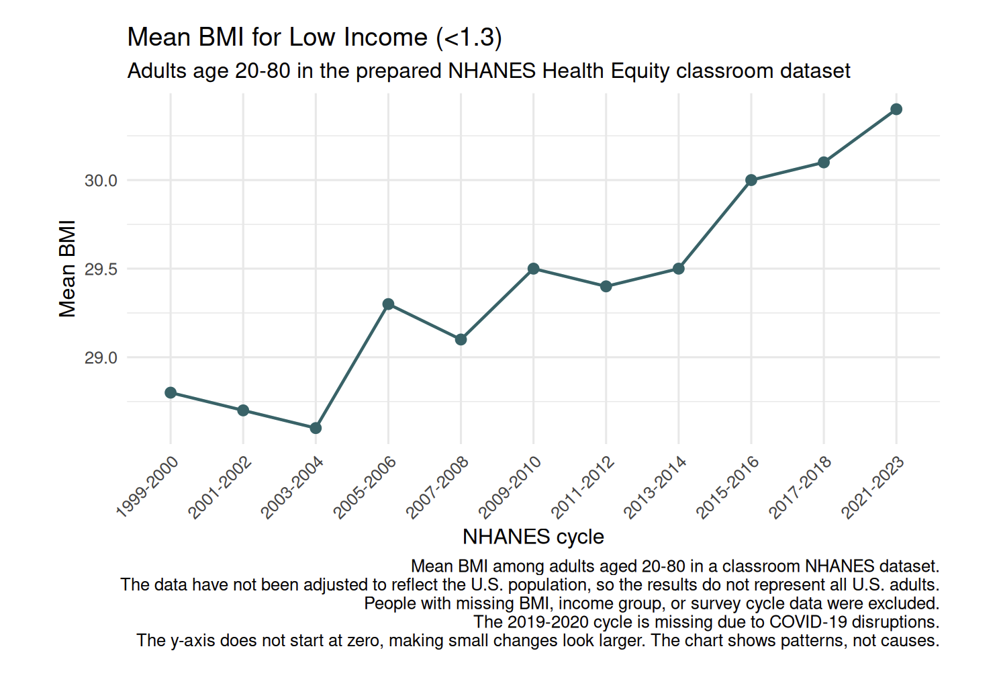

## Question And Audience

**Audience:** A new health reporter who received the NHANES BMI dashboard in a press package.

**Question:** In this classroom dataset, how did mean BMI change for low-income adults aged 20-80?

**Why it matters:** The reporter needs to decide which sentences about income and BMI are safe to publish.

## Evidence

{width="65%" fig-alt="Line chart of mean BMI for low-income adults aged 20-80 across 11 NHANES cycles, from 28.8 in 1999-2000 to 30.4 in 2021-2023."}

In the dashboard's Low Income (<1.3) view, mean BMI was 28.8 in 1999-2000 and 30.4 in 2021-2023, a change of under 2 units.

Source note: CDC/NCHS NHANES public-use data are the source for the NHANES classroom example [@cdc-nhanes].

## Takeaway

A safe sentence to report: "In one classroom NHANES dataset, low-income adults aged 20-80 had a slightly higher average BMI in recent survey cycles."

## Limitation And Next Step

**Limitation:** Results are unweighted, so they do not represent all U.S. adults. This view shows one income group, so it cannot show an income gap or that income causes higher BMI.

**Next step:** Before writing about income gaps, switch the dashboard to Middle and High Income. Before writing about a national trend, ask an analyst for weighted estimates.

**AI-use note:** AI suggested a slide order and plainer wording. I checked every number and limitation against my A7 summary table and notes.